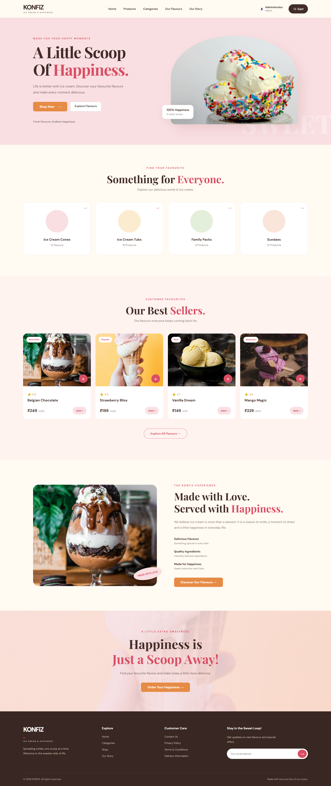

# Project Name

A modern and user-friendly web application built with React.js. Designed with a focus on simplicity, responsive design, and a smooth user experience.

## Project Screenshot

<p align="center">
  
</p>

## Features

- Simple and responsive user interface.
- Easy navigation and user-friendly design.
- Reusable React components.
- Fast and organized application structure.

## Technologies Used

- React.js
- JavaScript
- HTML5
- CSS3
- Node.js

## Installation and Setup

Clone the repository:

```bash
git clone YOUR_REPOSITORY_URL
```

Go to the project directory:

```bash
cd YOUR_PROJECT_NAME
```

Install dependencies:

```bash
npm install
```

Start the application:

```bash
npm start
```

Open http://localhost:3000 in your browser.

## Production Build

Create an optimized production build:

```bash
npm run build
```

## Developer

Developed using React.js with a focus on clean code, practical functionality, and a better user experience.


